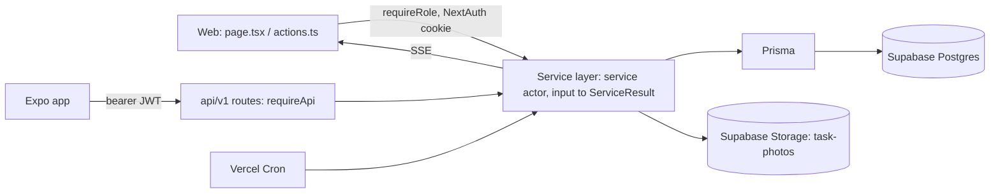

# Architecture: CompletePoolApp

Status: Complete

## Platforms
- Web app (office: Owner/Admin, plus workers on web if needed).
- Android mobile app (workers), Expo. iOS deferred.

## Stack
- Frontend: Next.js 14 (App Router), React, FullCalendar, `@react-pdf/renderer` for PDFs.
- Backend: Next.js server actions and REST routes (`src/app/api/v1`), a shared service layer in `src/server/services/*`, Prisma, Zod.
- Mobile: Expo SDK 57, expo-router, React Native 0.86, LeafletMap, SecureStore for tokens.

## Repo structure
Single repo, not a workspace monorepo. `mobile/` has its own `tsconfig.json`, `jest.config.js` and `metro.config.js`. It imports `src/contracts/*` as `@contracts/*`, so contracts must not import `@prisma/client` or `next`.

## Hosting and environments
- Local dev and Production only. There is no staging.
- `.env` points `DATABASE_URL`/`DIRECT_URL` at the live Supabase database, so every migration, seed or write needs confirmation.
- Web: Vercel (server clock is UTC). Mobile: Android APK with EAS Update (OTA).

## Auth provider
- Web: NextAuth credentials against the app's own `User` table. Supabase Auth is not used.
- Mobile: 15-minute HS256 access tokens (key derived from `NEXTAUTH_SECRET` via HKDF) and 30-day rotating refresh tokens. Reuse of a refresh token is treated as replay.
- `src/middleware.ts` gates routes by role prefix.

## External integrations and APIs
- Supabase Postgres and Storage (private `task-photos` bucket, signed upload/download URLs).
- Vercel Cron (`/api/cron/recurrence`, `/api/cron/photo-retention`).
- Expo EAS Update (OTA).
- Leaflet with OpenStreetMap tiles (mobile map).
- Stripe Checkout for online bill payment via a customer pay link (`/pay/<payToken>`); payments are deduplicated by `stripePaymentIntentId`.

## Config and env vars
`DATABASE_URL`, `DIRECT_URL`, `NEXTAUTH_SECRET`, `CRON_SECRET`, `SUPABASE_SERVICE_ROLE_KEY`, optional `SUPABASE_URL`, optional `PHOTO_RETENTION_DAYS` (default 183), mobile `EXPO_PUBLIC_API_URL` (defaults to production). Business timezone lives in `AppSettings`, not env.

## Diagram

## Key decisions
- One service layer with two thin transports, so business rules exist once.
- Services return `ServiceResult` instead of throwing; error messages are user-facing.
- Shared Zod contracts; enum parity enforced by `tsc` (`src/server/enumParity.ts`).
- All time is interpreted in the business timezone; mobile does no date arithmetic and compares server-provided `dayKey`/`businessDay` strings.
- Own auth table instead of Supabase Auth, to keep roles and the privilege ladder in one place.
- Photos are served only via short-lived signed URLs from a private bucket.
