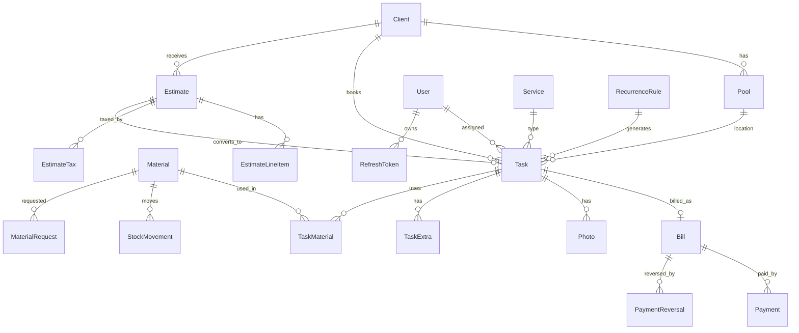

# Database: CompletePoolApp

Status: Complete

## Engine and hosting
PostgreSQL on Supabase. This is the live production database; there is no staging (see [ARCHITECTURE.md](ARCHITECTURE.md)). Ask before any migration, seed or write.

## ORM / query layer
Prisma (`prisma/schema.prisma`). Only `src/server/services/*` touch Prisma; pages and actions never query it directly. Decimals are serialized to numbers and Dates to ISO strings by `src/server/serialize.ts`. Tests mock Prisma and never need a database.

## Entities with key fields
- **User**: role (OWNER/ADMIN/WORKER), credentials, pay rate (history in `PayRateChange`).
- **Client**: name, phone, email, billing address, notes.
- **Pool**: clientId, service address, size, type, cached latitude/longitude/geocodedAt.
- **Service** / **ExtraService**: name, price, default duration.
- **RecurrenceRule**: frequency, daysOfWeek[], startDate, endDate.
- **Task**: client, pool, worker, service, date, startTime, durationMin, status, price, recurrenceRuleId, submittedAt/approvedAt/approvedById, flagReason.
- **TaskExtra**, **TaskMaterial**: priced snapshots at time of sale/use.
- **Photo**: taskId, url (private Storage path), type, uploadedAt.
- **Bill**: invoiceNo (sequential), taskId (unique), amount, status, payToken (unique), checkoutSessionId.
- **Payment**: receiptNo (sequential), billId, amount, method, stripePaymentIntentId (unique), recordedById.
- **PaymentReversal**: billId, reason, amountReversed, reversedById.
- **Material**: name, unit, costPrice, customerPrice, quantityOnHand, reorderThreshold, active.
- **MaterialRequest**: workerId, materialId?, quantityRequested, taskId?, urgent, status.
- **StockMovement**: materialId, type, signed quantity, taskId?, note.
- **Estimate** (+ **EstimateLineItem**, **EstimateTax**, **TaxRate**): client, pool?, status, signature data, snapshotted subtotal/taxTotal/total, convertedTaskId (unique).
- **AppSettings**: business timezone, business hours and other global settings.
- **Notification**: userId, read.
- **RefreshToken**, **ApiRateLimit**, **LoginAttempt**, **LoginSource**: auth and abuse protection.

## Relationships

## Indexes and constraints
- Unique: `Bill.invoiceNo`, `Bill.taskId`, `Bill.payToken`, `Payment.receiptNo`, `Payment.stripePaymentIntentId`, `Estimate.convertedTaskId`.
- Indexes: `Bill.status`, `Payment.billId`, `PaymentReversal.billId`, `PayRateChange(userId, createdAt)`, `Notification(userId, read)`, `RefreshToken` on userId/familyId/expiresAt, `updatedAt` on rate-limit tables.
- Rule: stock is decremented once per job; business rules live in services, not triggers.

## Migrations strategy
Apply with `prisma migrate deploy` only. Never run `prisma migrate dev` (`npm run prisma:migrate`) against this database: `_prisma_migrations` has a row for an uncommitted migration and `migrate dev` would try to reset the database. After editing the schema run `npm run prisma:generate`; new enum values must also be added to `src/contracts/enums.ts` (enforced by `tsc`).

## Seed data
No seeding against production without explicit approval. The public read-only demo user (`demo@completepool.app`) is the only seeded identity; see the Demo login note in project memory.

## Soft delete / audit trail
No global soft delete; some deletes are hard. Audit is by history tables: `PayRateChange`, `PaymentReversal` (payments are deleted, the reversal row is the standing record), `StockMovement`, and price snapshots on `TaskExtra`/`TaskMaterial`/`EstimateTax`. Billed jobs are locked.

## Backups and retention
Supabase automatic backups. The plan tier and point-in-time recovery are not verified here and need confirming in the Supabase dashboard. Task photos are purged after `PHOTO_RETENTION_DAYS` (default 183) by `/api/cron/photo-retention`.
